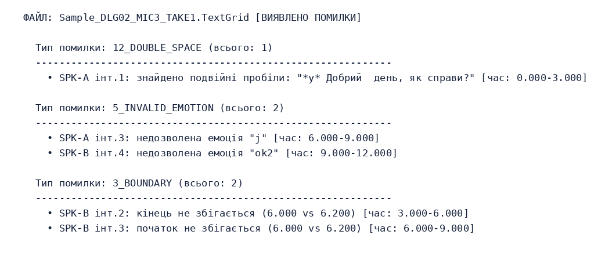

# Автоматична валідація TextGrid-анотацій

Програма на Python перевіряє якість анотацій мовленнєвого корпусу
(діалоги з конфліктним мовленням) і створює звіт із типом і місцем
кожної помилки. Замінює ручну перевірку, однакову для всіх файлів.



## Що перевіряє
- кількість і назви рівнів (`SPK-A-text`, `SPK-A-emo`, `SPK-B-text`, `SPK-B-emo`, `clap-sync`);
- синхронізацію часових меж між текстовим і емоційним рівнями кожного мовця;
- допустимі коди емоцій та правильність інтенсивності (1–3);
- наявність, кількість і формат мітки `clap`;
- початок реплік (маркер `*у*`), зайві пробіли, формат маркерів у зірочках;
- переплутані поля (текст у рівні емоцій і навпаки).

Усього понад 15 типів помилок, наприклад `3_BOUNDARY`, `5_INVALID_EMOTION`,
`8_CLAP_MISSING`, `12_DOUBLE_SPACE`.

## Як це працює
Клас `TextGridValidator` читає файл бібліотекою `textgrid`, перевіряє його
та повертає список помилок. Функція `find_annotation_files` знаходить файли
за шаблонами `DLG*/audio/MIC1|MIC2|MIC3/*.TextGrid` і `DLG*/sync/*.TextGrid`.
Звіт зберігається у `results/report.txt`.

## Формат вхідних даних

Програма розрахована на конкретну структуру корпусу. Якщо ваші дані
влаштовані інакше, код потрібно підлаштувати (див. нижче).

### Папки та назви файлів
Файли шукаються за такими шаблонами відносно вказаної папки:
```
DLG*/audio/MIC3/*.TextGrid
DLG*/audio/MIC1/*_synced.TextGrid
DLG*/audio/MIC2/*_synced.TextGrid
DLG*/sync/*.TextGrid
```
Тобто кожен діалог лежить у папці `DLG01`, `DLG02` тощо. Файли з мікрофонів
MIC1 і MIC2 мають закінчуватися на `_synced.TextGrid`, а назви файлів
з MIC3 довільні. Приклад: `DLG01/audio/MIC3/Sample_DLG01_MIC3_TAKE1.TextGrid`.

### Структура кожного TextGrid-файлу
- Рівно 5 рівнів (IntervalTier) з такими назвами:
  `SPK-A-text`, `SPK-A-emo`, `SPK-B-text`, `SPK-B-emo`, `clap-sync`.
- Текстовий і емоційний рівні кожного мовця мають однакову кількість
  інтервалів з однаковими часовими межами (допуск 0,001 с).
- Якщо в інтервалі є текст, у відповідному інтервалі емоційного рівня
  має бути код емоції, і навпаки.
- Перший інтервал текстового рівня, якщо він не порожній,
  починається з маркера `*у*`.
- Рівень `clap-sync` містить рівно одну непорожню мітку `clap`.

### Коди емоцій
- Базові коди `j`, `sad`, `an`, `f`, `nsur`, `psur`, `dis`, `con`, `ad`
  записуються з цифрою інтенсивності 1–3 (наприклад, `j2`, `sad1`).
- Коди `o` і `n` пишуться без цифри.

### Маркери в тексті
Позначки на кшталт `*см*`, `*шепіт*`, `*плач*` мають бути з пробілом
до і після та без пробілів усередині зірочок. Повний список допустимих
маркерів міститься в `VALID_STAR_MARKS`. Подвійні пробіли в тексті
вважаються помилкою.

## Як адаптувати до власних даних
Якщо ваша розмітка має іншу структуру, змініть у `validator.py`:
- назви рівнів: `EXPECTED_TIERS`;
- коди емоцій: `VALID_EMOTIONS`, `EMOTIONS_WITH_INTENSITY`, `EMOTIONS_WITHOUT_INTENSITY`;
- допустимі маркери: `VALID_STAR_MARKS`;
- шаблони пошуку файлів: список `patterns` у функції `find_annotation_files`;
- кількість рівнів: перевірка `len(tg.tiers) != 5` у `validate_file`.

## Структура репозиторію
```
textgrid-validator/
├── validator.py
├── requirements.txt
├── data/sample/              # синтетичні приклади (вигадані дані)
│   ├── DLG01/audio/MIC1|MIC2|MIC3/...
│   └── DLG02/audio/MIC3/...
└── results/
    ├── report_example.txt    # звіт на прикладах
    └── report_example.png
```

## Результат
На оригінальному корпусі з 24 файлів (4 діалоги, 3 мікрофони, 2 записи)
програма знайшла 2 помилки типу `3_BOUNDARY` (розбіжність меж інтервалів)
із точним зазначенням файлу, мовця й часу. На прикладах у `data/sample/`
(4 файли, один із навмисними помилками) знаходить 5 помилок 3 типів.

## Як запустити
```
pip install -r requirements.txt
python validator.py                  # перевіряє data/sample
python validator.py шлях/до/папки    # власні дані
```
Папка з даними має мати структуру `DLG*/audio/MIC*/...TextGrid`.
Звіт з'являється у `results/report.txt`.

## Дані
Реальні записи мовлення та їхні TextGrid-розмітки не публікуються,
бо це дані людей. У `data/sample/` лежать синтетичні файли з вигаданим
текстом, створені для демонстрації формату й роботи програми.
Один із них (`DLG02`) містить навмисні помилки, щоб показати,
як виглядає звіт.
